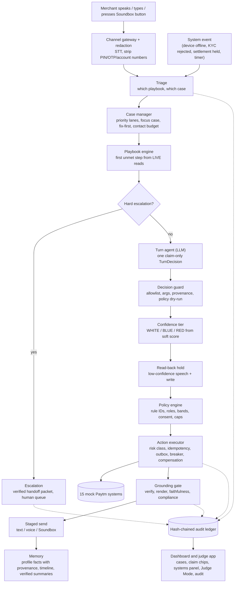
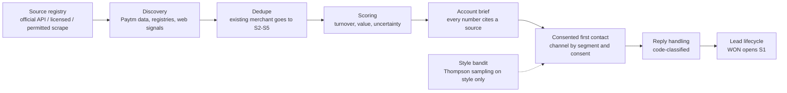

MUNIM
=====

**One AI teammate that finishes Paytm merchant cases end to end, across sales, customer service and field operations, by voice and text in Hindi, Kannada, Hinglish and English. It takes real actions on (mock) Paytm systems and can prove every sentence it says.**

Paytm Build for India AI Hackathon · Track 3: Autonomous AI Teammates · Finals 31 Oct 2026

> Every system Munim acts on is a mock, and all data is synthetic and labelled **SIMULATED** on screen. No real merchant data, Paytm fees or RBI figures are used as facts.

---

Overview
--------

Most "AI agents" answer questions and call tools. Munim is built for the part that comes after: actually **finishing** the case. That means getting a merchant from signup to first settlement, getting a silent Soundbox announcing payments again, or getting a held settlement released. It does this without ever saying something it cannot prove, and without doing something it is not allowed to do.

The design puts a deterministic engine in charge. The language model proposes one structured decision per turn. Code decides whether that decision may run, executes it exactly once, and checks every sentence of the reply against a real source before it is sent.

Before Munim says or does anything it answers five questions, each in code:

1. **What is this, and which case does it belong to?** (triage)
2. **What is the next step for this case, given what the systems say right now?** (playbook engine and done-checks on live reads)
3. **Is this action allowed, safe and reversible, and is a human needed?** (policy engine, risk classes, escalation)
4. **Can every sentence I'm about to say be proven from a real source?** (grounding gate)
5. **Did the job actually get done?** (done-checks on system state, never on the conversation)

---

Problem statement
-----------------

> *Design an AI teammate that can go beyond answering questions and deliver measurable outcomes in sales or customer service. The AI should understand context, make decisions, take actions, and work alongside human teams. How might we build an AI teammate that can independently handle a customer-service or sales workflow end-to-end, resolving issues, taking actions across systems, and escalating to humans only when needed?*

| Requirement | What Munim does |
|---|---|
| Understand context | Triage maps every message or system event to a playbook and a case. The turn agent sees a bounded, fenced context: playbook step, allowed actions, live case facts, other open cases, verified profile facts and knowledge snippets. Merchant text is quarantined as untrusted data. |
| Make decisions | One claim-only `TurnDecision` per turn (intents, focus case, at most one action, claims with sources), validated by a schema and a decision guard. |
| Take actions across systems | 15 mock Paytm systems reached only through one action executor with risk classes, deterministic idempotency keys, compensation and Undo, an outbox and circuit breakers. |
| Deliver measurable outcomes | A case is done only when its playbook's done-checks pass on live system reads (KYC approved, bank verified, first settlement settled, device online). Scenarios are scored on the final state of the mocks, never on the transcript. |
| Work alongside human teams | Server-built approvals, role permissions, a deadline-ordered handoff queue with verified handoff packets, return-to-agent, a rollout ladder (shadow, assisted, autonomous) and a kill switch. |
| Escalate only when needed | Hard triggers (a request for a person, regulatory words, fraud flags, tool outages, loops) plus a soft score from observable signals only. The model's own confidence is never an input. |

---

Features
--------

| Area | Capability |
|---|---|
| **Sales** | Activation from signup to first settlement (S1), Soundbox upsell (S2), eligibility-gated merchant loans (S3), plan change (S4), win-back of dormant merchants (S5). |
| **Customer service** | Settlement delay (C1), Soundbox fault with remote fix first (C2), failed customer payment (C3), merchant refund (C4), bank/KYC detail update (C5), charge dispute (C6), return and closure (C7), how-to from the knowledge base (C8), complaint (C9), Scam Shield (C10), honest refusal plus hand-off for unsupported requests (X0). |
| **Growth pipeline** | Lead discovery from Paytm's own data, official registries and permitted public sources through a source registry; duplicate matching; turnover estimate and lead scoring with uncertainty; account briefs where every number cites a source; consented first contact; code-classified reply handling; a lead lifecycle; Thompson-sampling style learning. |
| **Service intelligence** | Merchant health, usage-drop detection and predictive device faults; repeated-issue and root-cause detection; area incidents (many merchants failing together is one incident); fewer, merged, deadline-ordered tickets. |
| **Field operations** | One OR-Tools routing engine for sales reps and technicians with time windows; rep matching and technician assignment with hard rules; grounded briefings; visit logging with three proofs; territory redesign by load; privacy-bounded location and consent-gated coaching. |
| **Voice** | Push-to-talk (Sarvam `saaras` STT, `bulbul` TTS), full-duplex barge-in state machine, live language switching, read-back before acting on low-confidence speech, code-mix mirroring, and a zero-literacy client with no text field. |
| **Trust machinery** | Redaction on every inbound text; grounding gate (source, numbers, entailment, corroboration, render, back-translation faithfulness, compliance lines); default-deny policy engine with rule IDs; forbidden actions that do not exist; hash-chained audit ledger; replay from the ledger alone; self-verifying evidence packs. |
| **Proof for judges** | Judge Mode with persona cards and a ledger-computed scoreboard, phone client via single-use QR tokens, a guided tour, a guard-off twin, "Break Munim" arena with seven levels, a coverage matrix computed from test results, "Kyun nahi?" (why was this refused), a plain-language policy compiler that can only tighten policy, and questions to the ledger. |
| **Platform** | Domain-agnostic core with packs: Paytm merchant (full), Paytm consumer (C11, C12) and lender collections (D1, D2) running on the same core with no change to `core/`. MCP-shaped server generated from the action registry, signed agent-to-agent lender requests, an in-process event backbone with durable cursors, a mock mandate service, RFP drafting, and rival-network analysis behind an off-by-default legal flag. |
| **Evaluation** | Scenario runner scored on final state; metrics with 95% Wilson intervals and pass^k; guard ablations; a 32-scenario assurance suite; a one-shot frozen held-out run (Gate 4); a deck builder that refuses any number without a source. |

---

Why this is different
---------------------

1. **The AI never computes numbers.** Every number a merchant sees comes from a system read. Money is integer paise end to end. The model decides and the code enforces.
2. **Forbidden actions do not exist.** `approve_kyc`, `change_bank_details`, `change_settlement_account`, `credit_decision`, `delete_record`, `accept_documents_in_chat`, `request_otp` and `update_firmware` are not in the registry at all. Looking one up raises. A test (Gate #33) proves none can execute.
3. **Exactly once, even through crashes.** Every side effect goes through `core.actions.executor` with `sha256(case_id|action|canonical_json(args)|step_seq)` as the idempotency key. The ledger entry is written before the side effect, and a retry reuses the same key. Gate #10 proves it under injected timeouts, duplicates and restarts.
4. **Nothing unproven is said.** The model returns claims with source ids, not merchant-facing text. Code checks each claim and writes the reply only from verified claims plus fixed approved phrases, then back-translates it and checks it again. Gate #51 proves no unsupported claim reaches a merchant.
5. **Default-deny policy with no admin bypass.** A write not explicitly allowed by the current playbook step is refused. Humans go through the same policy engine and are checked by role. Offer actions are absent (not discouraged) while a P0/P1 service case is open (fix-first).
6. **Every guard is proven by removal.** The ablation table and assurance suite run each scenario with the guard on (no harm) and with only that guard removed (harm). A guard whose removal changes nothing proves nothing.

---

Architecture
------------

### End-to-end pipeline



### Core and packs

`core/` knows nothing about Paytm. Everything domain-specific lives in a **pack**: playbooks (YAML), the action vocabulary, mock systems, policy rules and limits, the approved knowledge base, phrases, intents, personas, and dev/held-out scenarios. Three packs run on the same engine:

| Pack | Subject | Playbooks |
|---|---|---|
| `packs/paytm_merchant/` | Merchant (M-xxxx) | S1–S5, C1–C10, X0 |
| `packs/paytm_consumer/` | Consumer (U-xxxx) | C11 UPI debited but failed, C12 refund not received |
| `packs/demo_lender/` | Borrower (B-xxxx) | D1 payment reminder, D2 consented promise-to-pay |

A playbook cannot grant a power the pack does not define. The loader rejects unknown actions, forbidden actions, unknown KB scopes, unknown done-check fields and any expression outside the safe expression language.

### Two loops

- **Case loop (per event):** the engine loop in `core/engine/workflow.py`. For every event it persists the EVENT ledger entry and an `engine_progress` row, and every planned intent with its ACTION_INTENT entry, **before** the executor is called. `recover()` finishes whatever is unfinished, and re-submitting reuses the same `step_seq`, so the effect happens once.
- **Supervision loop (per day):** background jobs (health, recurrence, incidents, ticket order, leads, outreach, style bandit) that **emit events and write their own tables**. They never message a merchant or call a mock. What to do about an event is the engine's and the humans' business.

### Why one agent, not many

A deterministic engine owns state and side effects and is the only writer. One turn agent proposes. Control flow is decided in code before untrusted text is read, so merchant text can change *what is said* but never *which tools exist*. An orchestrator routing to many specialist agents was rejected: decisions disperse, context is lost, and it is too slow for voice.

### Who decides what

| Decision | Made by |
|---|---|
| Which case and playbook | Triage (pure function, rule-based intents plus the model's intents as a disagreement signal) |
| Next step and whether the case is done | Playbook done-checks over live R0 reads |
| What to say and which single action to propose | The LLM (claims with sources only) |
| Whether the action may run | Decision guard, case-manager allowlist and fix-first, policy engine (again at execution time) |
| Every number, amount and date | System reads, never the model |
| Whether a sentence is sent | Grounding gate |
| Whether a human takes over | Hard triggers and the observable-signal soft score |
| Approval of R3 and out-of-band actions | A human with the right role, through the same policy engine |

---

Deep dive: the layers
---------------------

### Channel gateway and redaction (`core/memory/redact.py`, `core/voice/`)

Redaction runs on every inbound text **before** anything is stored or shown to a model. Speech-to-text output is data: it becomes a `MERCHANT_MESSAGE` event carrying redacted text, and nothing in the voice path calls an action.

- **Push-to-talk** (`core/voice/pipeline.py`, `/ws/voice`): audio in → `saaras` STT → redaction → event; reply text → `bulbul` TTS → audio out. `POST /api/voice/speak/{seq}` voices only a `MESSAGE_SENT` ledger entry, which is text the gate let through, scoped to the caller's session.
- **Full duplex** (`core/voice/duplex.py`): a pure barge-in state machine over injected frames and the `SimClock`.
- **Language switching** (`core/voice/language.py`): an explicit request ("Hindi mein bolo", "English please") saves the preference through the executor as an undoable R1 action. The preference is never inferred from a name, city or segment.
- **Read-back** (`core/voice/readback.py`): a write proposed on low-confidence speech is held as a pending confirmation. Code builds the read-back prompt from the integer arguments, and only a clear yes runs it.
- **Language bar** (`core/voice/language_bar.py`, `config/languages.yaml`): a language is on only with a passing report (STT, TTS, translation, ≤5% false blocks on ≥30 labelled replies, 0 leaks). The four baseline languages are on.

### Triage, case manager and playbooks (`core/engine/`)

- **Triage** (`triage.py`, `intents.py`): pure functions. Phrase lists per intent and per language (English, Hinglish, Devanagari, Kannada script) live in the pack and are all applied to every message, because people mix languages.
- **Case manager** (`case_manager.py`): priority lanes P0 (safety) → P1 (service) → P2 (activation) → P3 (offers), a focus case per merchant message, and **global fix-first**: `allowed_actions` never contains an offer action while a P0/P1 case is open.
- **Contact budget** (`contact_budget.py`): proactive touches counted per subject across all cases, with quiet hours, a daily cap and a weekly cap (values marked as assumptions in `limits.yaml`).
- **Playbooks** (`playbook.py`, `diagnose.py`, `safe_expr.py`, `fields.py`): each step has a `done` expression evaluated by a whitelist AST walker. Python's built-in evaluators are never used. `diagnose` re-reads every required read on every call, because a cached read after an action would close the case early.
- **Timers and events** (`timers.py`, `events.py`, `dispatcher.py`, `backbone.py`): an append-only event log deduplicated by `event_id`, timers that fire once and never after their case closes, and an in-process backbone with ordered delivery and durable consumer cursors (the Kafka-shaped contract a Redpanda adapter would keep).
- **Cases** (`cases.py`): every state transition writes its ledger STATE entry in the same transaction, and `rebuild` reconstructs a case's state from the ledger alone.

### Turn agent and context (`core/engine/turn.py`, `core/memory/context.py`, `core/llm/`)

`TurnAgent` is the engine's decider. In order, it:

1. picks the focus case that answers a merchant message (only once per message; other cases re-diagnose without a model call);
2. resolves a pending read-back confirmation first;
3. picks the reply language in code;
4. builds this turn's `SourceBook` (`tool:...` reads, `kb:...` passages in the playbook's scope, `policy:...` rules);
5. builds the bounded, fenced prompt with untrusted text quarantined;
6. asks the model for a `TurnDecision`, with one retry on invalid output (an outage or a second invalid output escalates);
7. runs the decision guard;
8. sets the confidence tier from the soft score;
9. holds a write on low-confidence speech for read-back;
10. runs the grounding gate, with one rewrite of the decision on `REWRITE`.

The `TurnDecision` schema forbids extra keys, so a `reply` or `message` field is a schema error. The LLM client (`core/llm/client.py`) puts Sarvam (`sarvam-105b`) and an optional OpenAI-compatible fallback behind one interface, with one retry per provider and every call attributed in the ledger. `core/llm/offline.py` is a rule-based stand-in for the two model calls, for running the real stack with no key.

### Grounding gate (`core/gate/`)

Nothing reaches the merchant except through `GroundingGate.run`.

| Step | What it checks |
|---|---|
| **Tier** (`tiers.py`) | WHITE sends. BLUE (0.45 ≤ S < 0.60) asks one fixed clarifying question and carries no action. RED (S ≥ 0.60, or a second BLUE in a row) sends the fixed hand-off line and escalates. |
| **Source check** (`sources.py`) | The claim's `source` id exists in this turn's SourceBook. |
| **Numbers check** (`numbers.py`, `sources.py`) | Every number, amount, date and time in the claim equals one in **that** source after normalisation (Indic digits, Hindi/Kannada number words, money as integer paise). |
| **Entailment** (`nli.py`, `verify.py`) | The source (premise) entails the claim (hypothesis), sentence by sentence. Tool results are verbalised first ("Device status is OFFLINE."). A lone premise sentence counts only if it shares a content word with the claim. |
| **Corroboration** (`corroboration.py`) | A categorical level computed by code from tool, KB and policy evidence. There is no weighted score. |
| **Render** (`render.py`) | The model writes sentences that either cite verified claim ids or name a fixed phrase id that code expands. It cannot reword approved text. |
| **Faithfulness** (`faithfulness.py`) | Every claim sentence's numbers must be in a cited claim, and its back-translation must be entailed by a verified claim. One re-render, then escalate. |
| **Compliance** (`compliance.py`) | Identity line and "Paytm never asks for your PIN or OTP" on first contact, a truthful yes to "are you an AI?", and the reply in the merchant's current language. |

Each call writes one `VERIFY` ledger entry with claim chips (level, colour, reason, rule id), sentences, checks and status: `SEND`, `CLARIFY`, `ESCALATE`, `REWRITE` or `NO_REPLY`.

**Knowledge** (`core/memory/knowledge.py`, `core/gate/retrieval.py`, `core/engine/knowledge_layer.py`): versioned markdown KB docs, hybrid retrieval (BM25 over FTS5 plus multilingual dense embeddings, fused by RRF, then a cross-encoder rerank), only current doc versions searchable, and answers built only from approved hits inside the playbook's `kb_scope`. Past-ticket hits are diagnosis hints and can never be quoted to a merchant.

### Policy engine, roles and approvals (`core/engine/policy.py`, `core/engine/roles.py`, `core/actions/approval.py`)

The policy engine is plain Python rule functions behind one interface, default-deny, with every limit read from `packs/*/policy/limits.yaml` (rules carry no literals). The Paytm merchant rules in `packs/paytm_merchant/policy/rules.py` are:

`FIX-FIRST-001` · `MONEY-LIMIT-001` · `WAIVER-BAND-001` · `RISK-HOLD-001` · `KYC-NO-CHAT-001` · `LOAN-KFS-001` · `LOAN-RATE-001` · `CONSENT-001` · `CONTACT-CAP-001` · `SECRET-001` · `CLOSE-NO-OBSTRUCT-001` · `MANDATE-LIMIT-001` · `INCIDENT-HOLD-001` · `RIVAL-TARGET-001` · `CONSENT-COACH-001` · `FIELD-NOTIFY-001` · `MCP-EXPOSE-001` · `ROLE-001`

The consumer and lender packs bring their own rules (for example, no threats or harassment, contact windows and no third-party disclosure in collections).

- **Roles** (`roles.py`): a permission matrix consulted only by `ROLE-001` inside the policy engine. There is no second code path and no admin bypass.
- **Approvals**: every field of an approval view is built from server data (the stored intent, registry, policy decision and reader snapshots). The model's explanation is stored under its own key and is never read by anything that builds an action field.
- **Plain-language policy compiler** (`core/judge/policy_compiler.py`): an operator types a rule in words → DSL dict → strict schema → tightening checks → dry run over every probe. It can only ever **tighten** policy.

### Action executor (`core/actions/`)

The only module that talks to a mock system.

```
validate args -> policy.evaluate
  -> [one transaction] actions row + idempotency reservation (+ outbox row for R3) + ledger ACTION_INTENT + ledger POLICY
  -> call the mock with the Idempotency-Key header (retries re-use the SAME key)
  -> [one transaction] record result + register compensation + mark outbox sent + ledger ACTION_RESULT
```

| Risk class | Meaning | Examples |
|---|---|---|
| `R0` | Read, no side effect | `get_kyc_status`, `get_settlements`, `get_device_status`, `check_partner_eligibility` |
| `DRAFT` | Prepares something, discardable | `draft_message`, `draft_ticket` |
| `R1` | Reversible exactly | `schedule_follow_up`, `book_visit_or_call`, `save_preference` |
| `R2` | Compensable within a window | `raise_ticket`, `create_device_replacement`, `apply_fee_waiver`, `create_refund_request`, `create_plan_change` |
| `R3` | Irreversible | `send_message`, `send_kyc_resume_link`, `restart_device`, `flag_fraud` |

- **Idempotency** (`idempotency.py`): the key is a pure function of the logical action.
- **Compensation and Undo** (`compensation.py`, `core/engine/merchant_undo.py`): successful R1/R2 actions register a compensation. Undo runs it through the same pipeline and is itself idempotent. A merchant can say "wapas karo" and only that case's last undoable action is reachable.
- **Outbox** (`outbox.py`): R3 sends are delivered only after the commit. Nothing is sent inside a transaction that can still roll back.
- **Circuit breaker** (`circuit_breaker.py`): per system, with state persisted. Three consecutive failures open it, and after 30 s of sim time one probe is allowed.
- **Mocks** (`packs/paytm_merchant/mocks/`): 15 systems (merchant, KYC, bank, device, payments, settlements, pricing, plans, risk, tickets, refunds, scheduler, closures, comms, lender) plus remote-fix faults, a mandate service and scenario controls. Every mutating endpoint requires `Idempotency-Key`, stores the response in the same transaction as the write, and replays it for a repeated key. Chaos (latency, 500s, timeouts after commit, duplicates) is injected by switches.

### Escalation and handoff (`core/engine/escalation.py`, `core/engine/handoff.py`)

- **Hard triggers**: any one escalates immediately. They are: a request for a person, a regulatory mention, a fraud signal, an amount above the money limit, an out-of-band offer, a settlement on risk hold, a bank name mismatch, a tool failure (`CIRCUIT_OPEN`, `UPSTREAM_UNAVAILABLE`), a loop, invalid model output twice, grounding failed twice, faithfulness failed twice, and the playbook's own `escalate_when` expressions.
- **Soft score**: `S = 0.30 f + 0.25 u + 0.20 n + 0.15 s + 0.10 v` (frustration, intent uncertainty, novelty, speech uncertainty, value at risk), from observable signals only.
- **Handoff packet**: summary sentences cite ledger sequence numbers (`ev:<seq>`). A deterministic checker drops any sentence whose citations do not exist or do not contain what the sentence claims. A merchant whose case is with a person gets a fixed hand-over line, never silence.
- **Human queue order** (`jobs/ticket_order.py`): lane (fraud/safety → money stuck → service down → information), then earliest deadline first, then value only on an exact tie.

### Memory, CRM and privacy (`core/memory/`)

- **Profile facts with provenance**: only `SYSTEM` facts can justify an action. A merchant's claim is stored as `MERCHANT_SAID`. History is never overwritten.
- **CRM gateway** with field-level permissions: the agent never touches KYC documents, bank details, credit decisions or settlement accounts.
- **Timeline**: every query binds the merchant id, and another merchant's id inside a payload is masked.
- **Verified episode summaries**: each sentence cites ledger entries.
- **Consent withdrawal and "delete my data"**: profile facts, summaries, CRM entries and stored transcript text are erased. Records the law or the audit trail requires (such as the hash-chained ledger and the append-only event log) are kept and never touched by deletion.

### Audit ledger (`core/audit/`)

```
h_0 = SHA256("MUNIM-GENESIS")
h_n = SHA256(h_{n-1} || canonical_json(entry_n minus volatile fields))
```

The ledger is append-only and tamper-evident. Replay (`replay.py`) folds a case from the ledger alone, with no model, no network and no wall clock, after re-verifying the whole chain. Evidence packs (`evidence.py`, `session_pack.py`) contain the transcript, claims with sources, rules fired, actions with idempotency keys, human actions with roles and the ledger slice with hashes. `scripts/verify_pack.py` checks a pack offline using only the standard library. Questions to the ledger (`questions.py`) map words to a fixed set of read-only query templates. No SQL is ever taken from text or written by a model.

### Sales growth pipeline (`jobs/`)



A lead is `WON` when it is handed to activation, not when the sale is made. The sale is done at the merchant's **first settlement**, which is S1's last done-check.

### Service intelligence (`jobs/`, `packs/paytm_merchant/scam_shield.py`)

- **Health and predictive faults** (`health.py`): emits `USAGE_DROP` and `DEVICE_DEGRADING`, separating a real drop from noise.
- **Recurrence** (`recurrence.py`): the same issue twice or more in 30 days is chronic, with root-cause tasks and fleet reports.
- **Area incidents** (`incidents.py`, `incident_map.py`): ≥10 devices in one pincode losing heartbeat within 10 minutes, or ≥10 settlements failing on one bank within 30 minutes, is one incident. The incident map is aggregated by pincode with a privacy floor.
- **Tickets** (`core/engine/tickets.py`): raise fewer, merge only on proof, link on suspicion.
- **Scam Shield (C10)**: a vision model reads only the fields of a "payment done" screenshot (amount, time, reference, app). Its schema rejects any verdict. Code decides MATCH / PENDING / no match from the merchant's own transactions, and the image is never stored.

### Field operations (`field/`)

| Module | What it does |
|---|---|
| `routing.py` | All stops of all people planned together with OR-Tools: time windows, shifts, optional stops in sales mode (orienteering), mandatory jobs in service mode. |
| `travel.py` | Road travel times by departure time, asymmetric. There is no straight-line fallback, so an unavailable provider raises instead of guessing. |
| `matching.py` | Rep-to-lead matching with hard rules (language for language-only merchants, training) before any scoring. |
| `assignment.py` | Technician assignment with hard rules (skill, parts, shift, daily cap, language). A job nobody passes stays unassigned with reasons. |
| `briefing.py` | Rep and technician briefings built from verified claims only and passed through the grounding gate. |
| `visits.py` | Visit voice notes become validated fields. A visit counts only with three proofs, including the merchant's confirmation. |
| `territory.py` | Territories balanced by load (sales opportunity plus service minutes), not shop count. |
| `profiles.py`, `privacy.py` | Profiles never hold protected traits. Location is recorded only inside an active shift and route. Coaching analysis needs consent. |

### Judge Mode and the proof layer (`core/judge/`)

- **Personas and snapshots**: persona cards with exact DB snapshots. Reset restores the SQLite file through the backup API, so the ledger, outbox, timers and keys all return to the snapshot.
- **Judge sessions and scoreboard**: a session is nothing but ledger entries, and the scoreboard (attempts, blocked claims, refused actions) is computed only from the ledger. Rate and cost caps are checked before the engine runs.
- **Phone client**: single-use `jt_` QR tokens bound to one persona. Only `sha256(token)` is stored.
- **Guided tour**: the steps are data, and progress is computed from the ledger on every call.
- **Guard-off twin**: a demo-only second engine with guards off, beside the real one. `twin.py` is the only place "guards off" exists, and a test greps the tree to prove it.
- **Break Munim arena**: each player gets a private sandbox with production guards on. Seven levels (bank change, KYC, credit, delete, unproven claim, unpoliced action, fix-first) are cleared only when a read-only SQL predicate over that sandbox's ledger is true.

### Rollout ladder (`core/eval/ladder.py`)

| Level | Meaning |
|---|---|
| L0 shadow | Munim drafts, a person does everything. |
| L1 assisted | Munim acts, a person approves each action. |
| L2 autonomous | Munim acts alone inside policy. |

Promotion happens on evidence and demotion is automatic. Every level change is written to the ledger.

### Integrations (`integrations/`)

- **MCP-shaped server** (`mcp/server.py`): JSON-RPC 2.0 with no third-party package. The tool list is generated from the action registry on every call. Only reads and drafts are listed by default, R3 is never listed and forbidden names can never appear.
- **Lender agent** (`lender_agent.py`): a signed, consent-scoped, token-only agent-to-agent request sent through the executor (`ask_lender_agent`). The lender decides eligibility, and a slow lender produces "I'll check and come back" with no decision.

---

Evaluation
----------

| Mechanism | Where | What it guarantees |
|---|---|---|
| **Scenarios** | `packs/*/scenarios/{dev,heldout}/`, `core/eval/scenario.py` | One persona, one hidden goal, a script of world events and the expected **final state of the mocks**. Success is never judged by an LLM reading a transcript. |
| **Merchant simulator** | `core/eval/simulator.py` | A seeded synthetic merchant (mood, honesty, code-mix) plays a scenario through the production message flow. |
| **Metrics** | `core/eval/metrics.py`, `munim eval --split dev` | Every rate comes with a 95% Wilson interval, zero counts use the rule of three, and repeated seeded runs give pass^k. Stale results are refused. |
| **Coverage matrix** | `core/eval/matrix.py`, `GET /api/coverage` | A playbook is "supported" only from recorded test results against the current code hash. Nobody marks it by hand. |
| **Ablations** | `core/eval/ablation_table.py`, `tests/test_ablations.py` | Each guard: no harm with it, harm with only it removed. |
| **Assurance suite** | `tests/test_assurance.py` | 32 scenarios (A1–A32), each safe with its guard and harmful without it. |
| **Gate 4: held-out run** | `core/eval/gate4.py`, `core/eval/heldout.py` | The held-out split runs **once per freeze hash** (code, prompts, policy, thresholds, playbooks, scenarios, frozen-set manifests, model weight revisions), enforced by a unique DB index. Deck numbers come only from that run. |
| **Deck builder** | `core/eval/deck.py`, `deck/slides.yaml`, `deck/figures.json` | Slide text holds no digits outside `{fig:…}`, `{metric:…}` or repository-count tokens. Paytm figures must be VERIFIED, and number words are rejected too. |
| **Cost and latency** | `core/eval/cost.py`, `core/eval/latency.py` | Cost per resolved case in integer paise from measured counts. Every rate is a labelled assumption. |

### The four gates

| Gate | Test | Property |
|---|---|---|
| #10 | `tests/gate_exactly_once.py` | Every side effect happens exactly once under retries, crashes, timeouts and duplicates. |
| #33 | `tests/gate_forbidden.py` | A forbidden action never executes, whatever the model, the human or the merchant asks. |
| #51 | `tests/gate_grounding.py` | Nothing unproven reaches a merchant. |
| #146 | `munim heldout --confirm` | One frozen held-out run, whose numbers are the only ones that reach the deck. |

**Results.** No headline numbers are printed here on purpose: the project's own rule is that a number reaches the deck only from the one frozen held-out run for the final code, and that run has not been done yet. See `docs/LIMITATIONS.md` and `docs/BUILD_STATUS.md` for what has and has not been measured.

---

Tech stack
----------

| Area | Technology |
|---|---|
| Backend | Python 3.12, FastAPI, Uvicorn, Pydantic 2, SQLite (WAL) |
| Language model and speech | Sarvam: `sarvam-105b` chat, `saaras` STT, `bulbul` TTS, `mayura` translate (`config/sarvam.yaml`). An optional OpenAI-compatible fallback (`config/llm.yaml`). |
| Grounding and retrieval | `cross-encoder/nli-deberta-v3-base` (NLI), `intfloat/multilingual-e5-small` (embeddings), `cross-encoder/mmarco-mMiniLMv2-L12-H384-v1` (rerank), BM25 over SQLite FTS5, sentence-transformers / transformers / torch (CPU) |
| Optimisation and graphs | OR-Tools (routing), NetworkX (incident graphs) |
| Testing | pytest, Hypothesis, Vitest |
| Frontends | Vite + React + TypeScript + Tailwind (`dashboard/`); Vite + React 19 + TypeScript + Tailwind 4 + motion (`web/`) |

---

Dashboards
----------

There are two frontends. Both proxy `/api`, `/approvals` and `/ws` to the backend on port 8000. The browser never polls: `/ws` pushes new ledger entries.

**`dashboard/` (port 5173)**, hash routes:

| Route | Screen |
|---|---|
| `#/cases`, `#/case/<id>` | Cases board and case view with claim chips, actions, timeline and cost |
| `#/systems` | Read-only snapshot of what the mock systems hold for a merchant |
| `#/handoffs` | Handoff queue with return-to-agent and verdicts |
| `#/audit` | Ledger with chain verification |
| `#/judge` | Judge Mode: persona cards, scoreboard from the ledger, break-it cards, tour, guard-off twin |
| `#/arena` | Break Munim |
| `#/coverage` | Coverage matrix and "Kyun nahi?" |
| `#/ladder` | Rollout ladder |
| `#/control` | Kill switch, sim clock, chaos, "customer pays" |
| `#/phone/<token>` | Merchant phone client (text and push-to-talk) |
| `#/simple/<token>` | Zero-literacy client: big icon buttons, every reply spoken, no text field |

**`web/` (port 5174)**: the judge-facing app (`docs/FRONTEND_PLAN.md`). It reuses the dashboard's API client and hooks read-only through an `@old` alias. Its screens are Case Floor, Judge Mode (with the tour and guard-off twin), Merchant phone, Systems, Handoffs, Coverage, Ladder, Arena, Control (including the plain-language policy compiler and the cost meter), Proof Ledger (with "Verify chain", "Ask the ledger" and "Kyun nahi?"), Design system and the Simple client. Old links (`#/cases`, `#/case`, `#/audit`) are aliased to the new screens.

---

Project structure
-----------------

```
Munim/
├── core/                       domain-agnostic core
│   ├── engine/                 workflow loop, triage, case manager, playbooks, turn agent, guard, escalation, handoff, policy, timers
│   ├── actions/                registry, executor, idempotency, outbox, compensation, circuit breaker, approvals
│   ├── gate/                   grounding gate: sources, numbers, NLI, corroboration, render, faithfulness, compliance, retrieval
│   ├── audit/                  hash-chained ledger, replay, evidence packs, questions to the ledger
│   ├── memory/                 SQLite store, redaction, context builder, profile, CRM, timeline, episodes, KB, deletion
│   ├── llm/                    LLM client, TurnDecision contract, Sarvam HTTP, offline stand-in, prompts
│   ├── voice/                  push-to-talk, duplex, language switching, read-back, language bar
│   ├── vision/                 screenshot field reader (no verdicts)
│   ├── judge/                  Judge Mode, personas, phone tokens, scoreboard, tour, twin, arena, policy compiler
│   ├── eval/                   scenarios, simulator, metrics, coverage matrix, ladder, ablations, Gate 4, held-out run, deck, cost
│   ├── api/                    FastAPI app, routes, WebSockets, dev server
│   └── cli.py                  munim replay | verify-ledger | eval | heldout
├── packs/
│   ├── paytm_merchant/         playbooks, actions, 15 mocks, policy rules + limits, KB, phrases, intents, Scam Shield, scenarios
│   ├── paytm_consumer/         C11, C12 on the same core
│   └── demo_lender/            D1, D2 lender collections on the same core
├── jobs/                       discovery, dedupe, scoring, briefs, outreach, replies, lead lifecycle, health, recurrence,
│                               incidents, incident map, ticket order, style bandit, RFP, rival analysis, playbook drafts
├── field/                      routing, travel, matching, assignment, briefings, visits, territory, profiles, privacy
├── integrations/               MCP-shaped server, lender agent client
├── dashboard/                  operator dashboard (Vite + React + TS + Tailwind)
├── web/                        judge-facing app (Vite + React 19 + Tailwind 4 + motion)
├── eval/frozen/                manifest-pinned frozen claim and policy-probe sets (LF endings; part of the freeze hash)
├── deck/                       slides.yaml, figures.json (source register), draft deck
├── config/                     sarvam.yaml, llm.yaml, voice.yaml, languages.yaml
├── data/                       seed.py (deterministic synthetic DB)
├── scripts/                    setup, preflight, Sarvam spike, pack verifier, synthetic screenshots, Indic NLI training
├── tests/                      gates, unit, scenario, assurance and ablation tests; harness (conftest, world, scenario_runner)
└── docs/                       build status, build plan, handoff, engineering rules, API contract, limitations, event kit
```

---

Installation
------------

Python 3.12 is required. On Windows, use the `py` launcher and set `PYTHONUTF8=1` (several modules read Hindi/Kannada sources without an explicit encoding).

**Windows**

```powershell
powershell -ExecutionPolicy Bypass -File scripts\setup_windows.ps1        # venv, deps, .env, hook, dashboard, tests
powershell -ExecutionPolicy Bypass -File scripts\setup_windows.ps1 -Ml    # also torch/transformers for the grounding tests
```

**Linux / macOS**

```bash
make setup         # venv, deps, hook, dashboard build, full pytest
make setup-ml      # torch/transformers for the grounding tests
```

**Manual**

```bash
py -3.12 -m venv .venv
.venv/Scripts/python -m pip install -r requirements.txt
.venv/Scripts/python -m pip install -r requirements-ml.txt   # NLI, embeddings, rerank
bash scripts/install_hooks.sh                                 # pre-commit secret grep
cd dashboard && npm ci && npm run build
```

Copy `.env.example` to `.env`. It is local only and must never be committed. `SARVAM_API_KEY` is needed only for live model and speech turns. The first model run downloads Hugging Face models. `make seed` reseeds `data/munim.db` deterministically (`data/seed.py --seed 42`).

---

Running it
----------

```bash
python -m core.api.dev_server --port 8000            # seeded DB, in-process mocks, real policy + executor, scripted decider (only S1 replies)
python -m core.api.dev_server --port 8000 --llm      # production turn agent: needs SARVAM_API_KEY and requirements-ml.txt
python -m core.api.dev_server --port 8000 --offline  # production turn agent with a rule-based stand-in for Sarvam (no key, no network)
npm --prefix dashboard run dev -- --port 5173        # operator dashboard
npm --prefix web run dev                             # judge-facing app on 5174
```

The dev server starts on a fresh seeded temp DB unless `--db` is given, and replays the demo S1 case unless `--no-demo` is passed. With `--llm` it runs one warm-up turn on a copy of the database (skip with `--no-warmup`) and prints the Arena admin token.

**Phone and simple clients:** `POST /api/judge/phone/tokens {"persona_id": "P-4", "ttl_s": 3600}`, then open `/?x=1#/phone/<token>` or `/?x=1#/simple/<token>`.

| Persona | Merchant | Situation |
|---|---|---|
| P-1 | M-0001 | KYC rejected, Soundbox offline, loan-eligible |
| P-2 | M-0002 | Settlement held |
| P-3 | M-0003 | Asks about a 0% loan |
| P-4 | M-0005 | Soundbox offline |
| P-5 | M-0006 | Stalled signup |
| P-6 | M-0010 | Failed payment |

**CLI**

```bash
python -m core.cli verify-ledger           # recompute the hash chain, report the first mismatch
python -m core.cli replay <case_id>        # rebuild a case from the ledger, offline
python -m core.cli eval --split dev        # metrics with intervals from recorded dev results
python -m core.cli heldout                 # Gate 4 dry run; --confirm runs and stores the ONE held-out run
python scripts/preflight.py                # pre-demo checks: keys set, build, frozen sets, held-out run, ledger, deck
python -m core.eval.deck --draft           # render the draft deck (the final deck needs the held-out run)
```

The API is documented in `docs/API_CONTRACT.md`.

---

Testing
-------

```bash
PYTHONUTF8=1 .venv/Scripts/python -m pytest                       # full suite (tens of minutes on Windows)
PYTHONUTF8=1 .venv/Scripts/python -m pytest tests/test_turn.py    # one file (preferred while working)
MUNIM_SKIP_MODEL_TESTS=1 .venv/Scripts/python -m pytest --ignore=tests/test_nli_gate.py --ignore=tests/test_retrieval.py
cd dashboard && npm test                                          # dashboard (Vitest)
```

- The test standard (`docs/ENGINEERING_RULES.md`): hand-counted expected values, a failing test for every "Watch out", and mutation checks on the riskiest guards (break the guard and the test must fail).
- `tests/test_checkpoint_s1.py` shows a whole case end to end. The harness lives in `tests/{conftest,world,scenario_runner,checkpoint_script}.py`.
- `tests/test_clock.py` lints the tree for wall-clock reads. Only `core/engine/clock.py` and `core/eval/latency.py` may read real time.
- A grep test proves no module except the executor calls a mock.
- Frozen sets (`eval/frozen/*`) and held-out scenarios are never used for tuning. Bugs are reproduced on new dev data.

---

Hard rules
----------

These are enforced by code and tests, never by prompts.

1. **The AI never computes numbers.** Every number comes from a system read. Money is integer paise.
2. **Every side effect goes through `core.actions.executor`** with deterministic idempotency keys. The ledger entry comes before the side effect.
3. **Policy is default-deny.** Forbidden actions do not exist in the registry. Humans go through the same policy, and there is no admin bypass.
4. **Nothing unverified is said.** Claims need a source in the turn's context with matching numbers. Offer tools are absent during open service cases.
5. **Never read the wall clock.** Time comes from the injected `SimClock`. IDs and seeds are deterministic.
6. **All data is synthetic** and labelled SIMULATED.
7. **Hindi, Kannada and Hinglish must be natural.** An unsure phrase is left out and flagged for native review.

---

Limitations
-----------

The full list with causes is in `docs/LIMITATIONS.md`. In short:

- All systems are mocks, chaos is injected, and time is simulated.
- Live Sarvam speech and model turns have been checked on a development machine but not run end to end in the build environment. The microphone path has no automated test.
- Hindi, Kannada and Hinglish phrasing has not had a full native-speaker review.
- There is no login in the demo API: a human's role is taken from the request, though every human action is still policy-checked and ledgered with that role.
- The Gate 4 held-out run has not been done for the current configuration, so no headline results exist yet.
- Only English, Hindi, Hinglish and Kannada are switched on. Seven other candidate languages have no labelled sets.
- Known false blocks remain where the entailment model stays neutral on true paraphrases, and Kannada compound number words are parsed incorrectly.
- Offline mode (`--offline`) is started but not finished or verified.

---

Glossary
--------

| Term | Meaning |
|---|---|
| **Pack** | Everything domain-specific: playbooks, actions, mocks, policy, KB, phrases, intents, scenarios. |
| **Playbook** | A YAML case type: triggers, required reads, steps with `done` checks, allowed actions, escalation rules, KB scope. |
| **Done-check** | A safe expression over live system reads that says whether a step (or the case) is finished. |
| **Lane** | Case priority: P0 safety (fraud, scams), P1 service (anything broken or disputed), P2 activation, P3 offers. |
| **Fix-first** | While a P0/P1 case is open, offer actions are removed from every allowlist. |
| **Risk class** | R0 read, DRAFT, R1 reversible, R2 compensable in a window, R3 irreversible. |
| **SourceBook** | The set of source ids (`tool:`, `kb:`, `policy:`) a claim may cite in one turn. |
| **Claim chip** | A claim's verification result shown in the UI: level, colour, reason, rule id. |
| **Tier** | WHITE (send), BLUE (clarify, no action), RED (hand off, escalate). |
| **Kyun nahi?** | "Why not?": the rules that refused an action, shown from the ledger. |
| **Guard-off twin** | A demo-only engine with guards removed, run beside the real one. |
| **Ledger** | The append-only, hash-chained record of every event, decision, policy check, action and reply. |
| **Gate 4 / held-out run** | The single frozen evaluation per configuration hash whose numbers alone may reach the deck. |
| **SIMULATED** | The on-screen label on all synthetic data and mock systems. |

---

Documentation
-------------

- `MUNIM_Bible_Merged.md`: the design intent (the why), sections 1–55.
- `MUNIM_Build_Map.md`: execution order, 160 tickets with Spec / Watch out / Test / Done when.
- `docs/BUILD_STATUS.md`: which tickets are done, partial or not started (read the "Status as of" section first).
- `docs/BUILD_PLAN.md`: everything still open to finals, row by row.
- `docs/HANDOFF.md`: what was just done and what is next.
- `docs/ENGINEERING_RULES.md`: file ownership, hard code rules and the test standard.
- `docs/API_CONTRACT.md`: the exact backend ↔ dashboard contract.
- `docs/FRONTEND_PLAN.md`: the judge-facing `web/` app.
- `docs/LIMITATIONS.md`: every limitation with its cause.
- `docs/EVENT_KIT.md`: interview guide, organiser request, shot plan, rehearsal run sheet and submission checklist.

---

Paytm Build for India AI Hackathon · Track 3: Autonomous AI Teammates · Bengaluru, 2026
